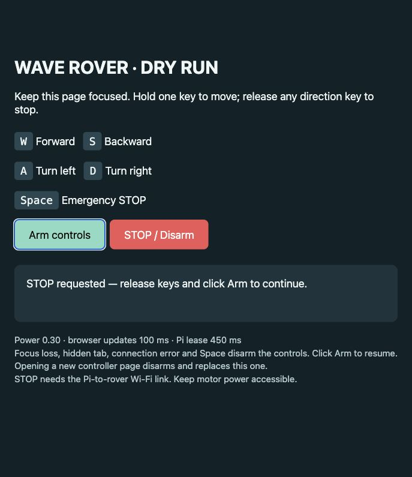

# WAVE ROVER hold-to-move keyboard controller

`rover_keyboard.py` is a separate Python 3.9+ controller using only the standard library. Run it on the Raspberry Pi; use a browser on your computer for the keyboard. No packages, edits to `rover_wifi.py`, or changes to wlan0, wlan1, SSH, routing, or Tailscale are needed. It sends your existing GET protocol to `http://192.168.4.1/js?json=...` with `T:1`, `L`, and `R` at power 0.30.

Validation: 13 automated tests use simulated motor transport. A browser dry run verified W, release-to-stop, and Space latching; backgrounding the browser triggered the Pi-side lease timeout. During setup on 2026-11-07, the operator confirmed the dry-run Space and focus-loss checks and reported successful live rover operation after testing forward movement and stopping on release. These observations do not establish hardware-side watchdog behavior.



Run the automated checks from the repository root without connecting to the rover:

```bash
python3 -m unittest discover -s tests -p 'test_rover_keyboard.py' -v
```

## 1. Copy the new file from your Mac

Run this from the **Team-17 repository root in a Mac terminal**, not at the Raspberry Pi prompt. The example SSH destination is `khoj@raspberrypi`; replace it with your Pi login if different. The existing `~/ugv_rpi` directory must already exist. This command refuses to overwrite an existing `rover_keyboard.py`. Leave your working `rover_wifi.py` alone.

```bash
ssh khoj@raspberrypi 'set -C; cat > ~/ugv_rpi/rover_keyboard.py' < rover/rover_keyboard.py
```

No output normally means the copy succeeded. If it reports an existing file, stop and inspect it before choosing another name. If you downloaded the script elsewhere, change only the local path after `<`.

## 2. Open the tunnel and run the dry test

In a Mac terminal, open a new SSH session with a local browser tunnel:

```bash
ssh -o ExitOnForwardFailure=yes -L 127.0.0.1:18765:127.0.0.1:18765 khoj@raspberrypi
```

At the resulting **Pi prompt**:

```bash
cd ~/ugv_rpi
python3 rover_keyboard.py --port 18765
```

Keep that terminal open. The script must say `DRY RUN (no rover requests)`. Without `--live`, it never contacts the rover, including for STOP.

On your Mac, open [the local controller](http://localhost:18765/). Use this browser page for WASD, not the SSH terminal. Browser [keyup events](https://developer.mozilla.org/en-US/docs/Web/API/Element/keyup_event) provide key-release information that ordinary SSH terminal input cannot reliably provide.

1. Click **Arm controls** and wait for the armed status.
2. Hold **W** briefly, then release it. The Pi terminal should print `L: 0.3, R: 0.3`, followed by zeros on release.
3. Try **A**, **S**, and **D**. Repeated identical commands are sent internally but only changes are printed in dry mode.
4. Press **Space**. W/A/S/D must do nothing until you click Arm again and make a fresh key press.
5. Re-arm, then switch to another application or browser tab. Returning to the page should show disarmed controls.
6. With the page armed, close it or interrupt the tunnel. The still-running Pi controller should disarm after missed browser updates and simulate STOP. If the SSH session also ends, orderly signal cleanup attempts STOP too.

Release any direction key to stop. Two simultaneous direction keys request STOP; there is no diagonal driving. After a release, remaining held keys do not resume movement. Press a direction key afresh. Space, Escape, the STOP button, focus loss, hidden tabs, and connection errors disarm the controller. Opening or refreshing the controller page also disarms it and invalidates older pages.

If either side says the port is occupied, use a different unused port in **all three places**: the SSH tunnel's two port numbers, `--port`, and the browser URL. This guide uses 18765; the script's default, when `--port` is omitted, is 8765.

## 3. Live test, after the dry test works

Secure the rover with wheels off the ground, hands clear, and motor power accessible. Ensure your old script and other rover controls are not running at the same time.

Close the controller browser tab first, so its polling does not produce SSH forwarding errors while the server is stopped. In the Pi terminal, stop the dry run with **Ctrl+C**, then run:

```bash
python3 rover_keyboard.py --port 18765 --live
```

Reopen the browser page at `http://localhost:18765/`. It must show **LIVE** and start disarmed. The script immediately sends STOP and continues sending zeros while disarmed. If it cannot receive a STOP HTTP response, it refuses to arm.

First arm, briefly hold W, and release. Verify the wheels physically stop before testing the other directions. Then test Space, focus loss, and Ctrl+C. Do not intentionally disconnect the rover Wi-Fi while it is moving to test the watchdog; that could remove the ability to deliver STOP. Start ground tests only after the raised-wheel checks pass.

Direction mapping, matching the earlier working script:

| Key | L | R | Action |
| --- | ---: | ---: | --- |
| W | 0.30 | 0.30 | Forward |
| S | -0.30 | -0.30 | Backward |
| A | -0.30 | 0.30 | Rotate left |
| D | 0.30 | -0.30 | Rotate right |
| Release / STOP | 0 | 0 | Stop request |

## Timing and failure behavior

- The focused browser sends its current key state about every 100 ms, independent of operating-system key repeat.
- A Pi worker repeats the current motor command about every 100 ms. It also repeats STOP while idle or disarmed. These rates need validation against the real rover's response times; slow or failed requests disarm the controls.
- If the Pi sees no valid browser update for 450 ms, it disarms and requests STOP. The worker checks on its next cycle, so scheduling and an in-flight HTTP request add delay. A late heartbeat cannot re-arm it. You must click Arm again.
- Commands carry increasing sequence numbers so an older browser request cannot replace a newer STOP. Each new page gets a new session token.
- Only one worker sends rover HTTP requests. Release and emergency STOP update its state immediately; an HTTP request already in progress must finish or time out before it can send STOP. The 250 ms socket timeout is not a strict end-to-end timing bound.
- Any rover request failure disarms the controller. The worker then retries only STOP. Communication recovery does not resume movement automatically; a successful STOP response and explicit Arm are required.
- Ctrl+C, SIGTERM and SIGHUP request shutdown and give the worker a short opportunity to deliver STOP. This cannot cover SIGKILL, a crashed/frozen Pi, power loss, or a broken Pi-to-rover Wi-Fi link.

**The 450 ms lease is a Pi-side software watchdog. No hardware-side watchdog is assumed or configured.** HTTP success only confirms an HTTP response, not wheel motion or standstill. If STOP cannot reach the rover, motors may continue with the last command. Confirm stopping physically and keep the power switch accessible. A firmware-side motor-command timeout would need to be identified in the installed firmware and separately verified before relying on it.

The web server binds only to the Pi's `127.0.0.1` and is reached through your SSH tunnel. It serves no files, checks the host/origin, and requires a per-page token for controls. Keep it local; Python's built-in [HTTP server](https://docs.python.org/3/library/http.server.html) is intended for limited local use rather than public hosting.

## Troubleshooting

`channel 2: open failed: connect failed: Connection refused` means the SSH tunnel could not connect to the controller on the Pi. In this setup, it appeared when the browser kept polling after the Python server had been stopped. Close the browser tab, start the controller on the matching port, and reopen the tab. Keep the Python process running; do not enter commands at that prompt until stopping it with Ctrl+C. No Wi-Fi or Tailscale changes are needed for this case.

A Mac path beginning with `/Users/` cannot be used as a local source from the Pi shell. Run the copy command on the Mac. The prompt `khoj@raspberrypi` identifies the Pi session.

## Stopping and rollback

Press Space or click STOP, close the controller browser tab, then use Ctrl+C in the Pi terminal. Closing the tab first avoids repeated SSH forwarding errors. Close the SSH session when finished. Run the original `rover_wifi.py` as before whenever the new controller is stopped. No services, autostart entries, firewall rules, or network settings are installed.

If the existing Pi-to-rover connection works and you need an additional manual stop attempt in a second Pi terminal:

```bash
python3 ~/ugv_rpi/rover_wifi.py stop
```

That command depends on the same Wi-Fi connection and is not an independent emergency-stop mechanism.
